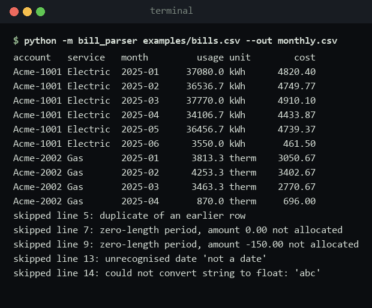

<p align="center"></p>

# utility-bill-parser

A command-line tool that cleans a utility bill CSV and spreads each bill's usage and cost across the calendar months it covers.



## What it is for

Utility bills arrive as exports with mixed date formats, dollar signs, credits in parentheses, repeated rows and billing periods that cross month ends. Energy managers, facility managers and building operators cannot chart or benchmark them until each bill is cleaned and assigned to calendar months. This tool reads a bill CSV, cleans each row, reports every row it could not use, and spreads usage and cost across the months each bill covers.

## Install

```
git clone <this repo>
cd utility-bill-parser
pip install -r requirements.txt pytest
```

Python 3.10 or newer. No runtime dependencies. Run with `PYTHONPATH=src` (on Windows PowerShell set `$env:PYTHONPATH = "src"` first), or install with `pip install -e .`.

## How to use

Expected columns: `Account, Service, Period Start, Period End, Usage, Unit, Amount`. The table goes to stdout and skipped rows go to stderr, each with its line number.

| I want to | Command |
|---|---|
| Print the monthly series for a bill file | `python -m bill_parser examples/bills.csv` |
| Also write the monthly series to a CSV file | `python -m bill_parser examples/bills.csv --out monthly.csv` |

Worked example (the example data is invented):

```
PYTHONPATH=src python -m bill_parser examples/bills.csv --out monthly.csv
```

Output, table first and then the skipped rows:

```
account   service   month         usage unit        cost
Acme-1001 Electric  2025-01     37080.0 kWh      4820.40
Acme-1001 Electric  2025-02     36536.7 kWh      4749.77
Acme-1001 Electric  2025-03     37770.0 kWh      4910.10
Acme-1001 Electric  2025-04     34106.7 kWh      4433.87
Acme-1001 Electric  2025-05     36456.7 kWh      4739.37
Acme-1001 Electric  2025-06      3550.0 kWh       461.50
Acme-2002 Gas       2025-01      3813.3 therm    3050.67
Acme-2002 Gas       2025-02      4253.3 therm    3402.67
Acme-2002 Gas       2025-03      3463.3 therm    2770.67
Acme-2002 Gas       2025-04       870.0 therm     696.00
skipped line 5: duplicate of an earlier row
skipped line 7: zero-length period, amount 0.00 not allocated
skipped line 9: zero-length period, amount -150.00 not allocated
skipped line 13: unrecognised date 'not a date'
skipped line 14: could not convert string to float: 'abc'
```

## How it works

1. Dates are tried against five formats (`2025-03-06`, `03/06/2025`, `03/06/25`, `Mar 6, 2025`, `March 6, 2025`).
2. Amounts drop `$` and commas; `($150.00)` becomes -150.00. Usage may contain commas.
3. A row that cannot be parsed, ends before it starts, has zero length or repeats an earlier row is left out and listed with its line number. Nothing is dropped silently.
4. A period runs from its start date up to, not including, its end date. Each day gets an equal share of the bill's usage and cost.
5. Shares are totalled per account, service, month and unit, so the monthly totals add up to the bills used.

## Limits

- Daily proration assumes use is even across the period. It does not use weather or occupancy.
- Zero-length credit rows are reported, not applied. Review them by hand.
- Units are kept as written; the tool does not convert between them (see eui-calculator for that).

## License

MIT, see LICENSE. Author: Yassine Emhamed.
